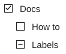
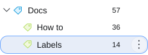

# Labels  

Press **L** to search and apply labels; use Up/Down, Space to toggle and Escape to close.
In the list, changes apply to selected messages; in the conversation reader, they apply to the whole resolved conversation, including sent replies.
Numeric tag shortcuts target the active message, identified by a slim marker.

The **×** removes a label only from that message; clicking the chip opens matching mail across folders.

A mixed checkbox means only some messages have the label; wait for conversation loading before applying changes, and check reported failures on cross-folder updates.

## Nested labels

Enable Thunderbird’s **Tags** folder-pane mode to see the label tree. [View > Folder > Tags]

Names such as `Work/Project` create nesting; use **Create new → Nest label under** in the picker to choose a parent.
Parent and child assignments are independent, and synchronization depends on your mail provider and other clients.

## Sidebar menu

Hover or focus a label and open [ **⋮** ] to change its color, hide its list chips, edit it, remove it or add a sublabel.

Hiding chips keeps assignments; removing a label keeps emails and sublabels.
**Edit** renames descendants too, unlike Thunderbird’s native tag editor; **Add sublabel** creates a label without assigning it to selected mail.

## Label list visibility

Open a label’s three-dot menu and use **In label list**: **Show**, **Show if unread**, or **Hide**. The default is Show. Hidden labels, including unread-only labels with no unread messages, can be revealed with **More** at the bottom of Labels; **Less** collapses them again. Revealed labels retain their normal nested hierarchy.

A visible child keeps its parent path accessible. The currently selected label also stays visible until you navigate elsewhere, even if its unread count reaches zero. Choices are stored by stable native tag key, so renaming a label preserves its setting. These choices are independent of **In message list**, which controls chips beside email subjects.

Unread visibility uses Thunderbird’s existing native counts and change notifications. It does not scan mail or poll the server; label hierarchy updates are cached and notification bursts are batched.
